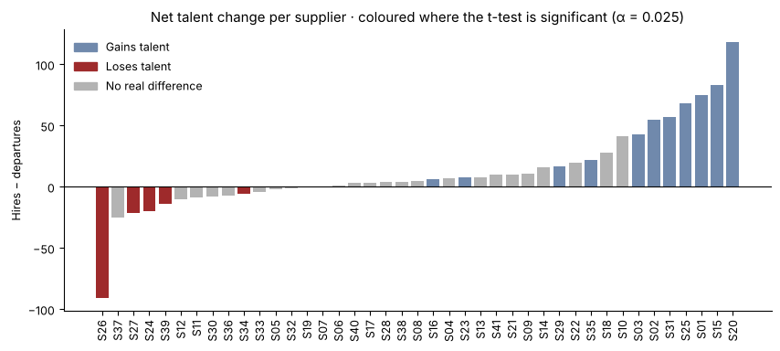
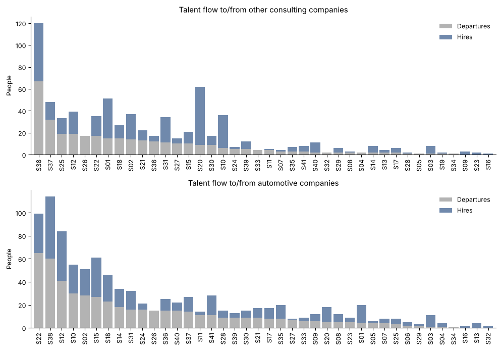

# Consulting Supplier Talent Analysis

Which consulting suppliers attract more tech talent than they lose, and is the difference larger than normal turnover?

This project analyses **talent movement for 41 consulting suppliers in Sweden** over 12 months (up to 18 October 2023), using company reports from **LinkedIn Talent Insights**. It was part of a supplier comparison for an automotive company, and combines data preparation in Python, exploratory analysis and **statistical hypothesis testing**.



## Key results

- Across the 41 suppliers, **2,154 people were hired and 1,649 left** (net +505). **26 of 41** suppliers gained more people than they lost.
- **The automotive industry is the only group the suppliers lose talent to on balance** (511 departures vs 448 hires). Automotive companies receive about 31% of all departures.
- A per-supplier **t-test (α = 0.025)** shows a real imbalance for **16 of 41 suppliers**: 11 gain talent and 5 lose talent.
- A paired **Wilcoxon signed-rank test**, added as a robustness check, agrees with the t-test for 33 of 41 suppliers and is the better default for this paired, skewed count data.



## Project structure

```
├── notebooks/
│   ├── 01_data_quality_checks.ipynb   missing values, duplicates, consistency of derived columns
│   ├── 02_talent_flow_analysis.ipynb  flows per supplier and counterparty type, correlations
│   └── 03_hypothesis_testing.ipynb    t-test per supplier + Wilcoxon robustness check
├── src/
│   ├── prepare_data.py                merge subsidiary reports, combine all supplier reports, clean locations
│   └── anonymize.py                   build the anonymized analysis table
├── data/                              not included, see data/README.md
├── images/                            charts used in this README
└── requirements.txt
```

## Method

1. **Data preparation** (`src/prepare_data.py`)
   - Merge the reports of a parent company's subsidiaries into one report (sums, recalculated growth, attrition and ratios).
   - Combine the 12-sheet Excel report of every supplier into one workbook.
   - Tag each counterparty company as *consulting* and/or *automotive* using two reference lists (regex matching on lower-case names).
   - Clean location names and split them into city and county.
2. **Anonymization** (`src/anonymize.py`): suppliers become S01–S41 and counterparties C0001…, so no company names from the licensed data are published.
3. **Data quality checks** (notebook 01): missing values, duplicated supplier–counterparty pairs, negative counts, and whether `net_change` and `ratio` match the raw counts. This check found a ratio bug in the original merge step, which is now fixed.
4. **Analysis** (notebook 02): totals per supplier and per counterparty type, top lists, correlation between the measures.
5. **Hypothesis testing** (notebook 03):
   - H0: departures = hires, H1: departures ≠ hires, tested per supplier across its counterparties.
   - Independent two-sample t-test (`scipy.stats.ttest_ind`), α = 0.025.
   - Robustness check with a paired Wilcoxon signed-rank test (`scipy.stats.wilcoxon`).

## Tools

Python · pandas · NumPy · SciPy · Matplotlib · Seaborn · openpyxl · Jupyter. The final supplier comparison was presented to management in Power BI (not included).

## How to run

```bash
pip install -r requirements.txt

# 1. merge subsidiaries (one folder per parent company), then combine all supplier reports
python src/prepare_data.py merge   --input data/raw/to_merge/<parent> --output data/raw/in/<parent>.xlsx
python src/prepare_data.py combine --input data/raw/in --filters data/raw/filter --output data/processed/combined.xlsx

# 2. anonymize
python src/anonymize.py --input data/processed/combined.xlsx --output data/processed/company_movements.csv --seed <private number>

# 3. open the notebooks in order
jupyter notebook notebooks/
```

The raw data is licensed and not part of this repository, so the notebooks are saved with their outputs.

## Author

**Zohreh Karimi Behbahani**, Data Analyst · BSc in Statistics · [LinkedIn](https://www.linkedin.com/in/zohreh-behbahani/)
